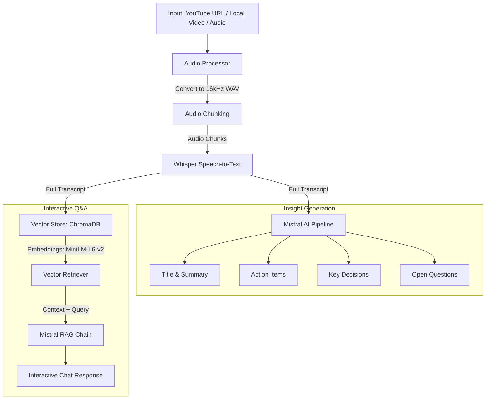

# 🎬 VidSage AI — AI Video & Meeting summarize application

[](https://www.python.org/)
[](https://streamlit.io/)
[](https://www.langchain.com/)
[](https://github.com/openai/whisper)
[](https://www.trychroma.com/)
[](https://mistral.ai/)

**VidSage AI** is an intelligent, end-to-end Video & Meeting Assistant powered by **OpenAI Whisper**, **LangChain**, **Mistral AI**, and **ChromaDB**. It transcribes long videos or audio files (from YouTube URLs or local uploads), breaks them into manageable chunks, generates comprehensive summaries and titles, extracts action items and key decisions, and builds an interactive **Retrieval-Augmented Generation (RAG)** pipeline allowing you to chat directly with your video content.

---

## 🚀 Key Features

- 📹 **Flexible Input Ingestion**:
  - Direct YouTube URL downloading via `yt-dlp`.
  - Local video & audio uploads (`.mp4`, `.mkv`, `.mov`, `.avi`, `.mp3`, `.wav`, `.m4a`, `.webm`).
- 🎙️ **Local Speech-to-Text Transcription**:
  - Powered by **OpenAI Whisper** models (`tiny`, `base`, `small`, `medium`, `large`).
  - Automatic GPU (CUDA) detection with seamless CPU fallback.
  - Smart audio pre-processing (16kHz mono WAV conversion) and time-based chunking.
- 🧠 **Intelligent Insight Extraction**:
  - **Executive Summary**: High-level and detailed takeaways with map-reduce support for long transcripts.
  - **Action Items**: Concrete tasks with assigned owners and deadlines.
  - **Key Decisions**: Crucial decisions made during the meeting or video.
  - **Open Questions**: Unresolved topics and follow-up queries.
- 💬 **Interactive RAG Chat Engine**:
  - Embeds transcripts using HuggingFace `all-MiniLM-L6-v2`.
  - Stored in a local persistent **ChromaDB** vector database.
  - Ask natural language questions grounded strictly in the transcript context.
- 🖥️ **Dual Interfaces**:
  - **Modern Streamlit Dashboard**: Sleek UI with real-time terminal output, progress bars, tabbed analytics, and chat.
  - **Command-Line Interface (CLI)**: Fast, scriptable terminal execution.

---

## 🏗️ System Architecture



---

## 📂 Project Structure

```text
AI_Video_Assistant_With_RAG/
│
├── core/
│   ├── transcriber.py       # OpenAI Whisper loading and chunked audio transcription
│   ├── summarizer.py        # Executive summary and title generation via Mistral
│   ├── extractor.py         # Extracts action items, decisions, and questions
│   ├── vector_stor.py       # ChromaDB vector store initialization & retriever setup
│   └── rag_engine.py        # LCEL RAG chain for natural language chat
│
├── utils/
│   └── audio_processor.py   # YouTube downloading, FFmpeg WAV conversion & chunking
│
├── app.py                   # Full-featured Streamlit web application
├── main.py                  # CLI pipeline entry point
├── requirements.txt         # Project dependencies
├── .env                     # API keys and runtime configuration
└── README.md                # Project documentation
```

---

## 🛠️ Prerequisites

1. **Python**: Recommended `3.10`, `3.11`, or `3.12`.
2. **FFmpeg**: Required by `yt-dlp` and `pydub` for audio extraction and conversion.
   - **Windows**: Install via `winget install Gyan.FFmpeg` or `choco install ffmpeg`, and ensure `ffmpeg` is added to your system `PATH`.
   - **macOS**: `brew install ffmpeg`
   - **Linux**: `sudo apt install ffmpeg`
3. **Mistral AI API Key**: Get a free API key from [Mistral AI Console](https://console.mistral.ai/).

---

## ⚙️ Installation & Setup

### 1. Clone the Repository
```bash
git clone https://github.com/your-username/AI_Video_Assistant_With_RAG.git
cd AI_Video_Assistant_With_RAG
```

### 2. Create a Virtual Environment

Using standard Python `venv`:
```bash
python -m venv .venv
# Windows PowerShell:
.venv\Scripts\Activate.ps1
# Linux / macOS:
source .venv/bin/activate
```

*(Optional) If using `uv`:*
```bash
uv venv .venv --python 3.12
.venv\Scripts\activate
```

### 3. Install Dependencies

```bash
pip install -r requirements.txt
```

> **GPU Acceleration (Optional, NVIDIA GPUs):**
> If you have an NVIDIA GPU and wish to use CUDA for 5-10x faster transcription, install the CUDA PyTorch wheel:
> ```bash
> pip install torch torchvision torchaudio --index-url https://download.pytorch.org/whl/cu124
> ```

### 4. Configure Environment Variables

Create a `.env` file in the project root:

```ini
# Mistral AI API Key
MISTRAL_API_KEY="your_mistral_api_key_here"

# Whisper Model (options: tiny, base, small, medium, large)
WHISPER_MODEL="base"

# Mistral LLM Model (open-mistral-nemo, open-mistral-7b, mistral-small-latest)
MISTRAL_MODEL="open-mistral-nemo"
```

---

## 💻 Usage

### Option 1: Launch the Streamlit Web Application

```bash
streamlit run app.py
```
*(Or simply `python app.py` — VidSage AI automatically detects and forwards to Streamlit).*

**In the Web UI, you can:**
1. Paste a YouTube URL or upload a video/audio file.
2. Watch real-time execution logs and live progress bars as Whisper and Mistral process the content.
3. Review the generated Title, Summary, Action Items, Decisions, and Full Transcript.
4. Chat with the video interactively using grounded RAG.
5. Download any report as `.txt` files.

---

### Option 2: Run via CLI

```bash
python main.py
```

Follow the interactive prompts:
```text
Enter YouTube URL or local file path: https://youtu.be/EXAMPLE
Please enter translate (True/False): False
Starting AI Video Assistant ⤵
...
📌 Title: Machine Learning Deployment
📋 Summary: ...
✅ Action Items: ...
🔑 Key Decisions: ...
💬 Chat with your meeting (type 'exit' to quit)
You: What were the next steps agreed upon?
```

---

## 🧩 Tech Stack

- **Speech Recognition**: [OpenAI Whisper](https://github.com/openai/whisper)
- **Audio Processing**: [yt-dlp](https://github.com/yt-dlp/yt-dlp), [pydub](https://github.com/jiaaro/pydub), [FFmpeg](https://ffmpeg.org/)
- **LLM & Orchestration**: [LangChain (LCEL)](https://python.langchain.com/), [Mistral AI](https://mistral.ai/)
- **Embeddings & Vector Database**: [ChromaDB](https://www.trychroma.com/), [HuggingFace Sentence-Transformers](https://huggingface.co/sentence-transformers/all-MiniLM-L6-v2)
- **Frontend**: [Streamlit](https://streamlit.io/)

---

## 🤝 Contributing

Contributions, issues, and feature requests are welcome! Feel free to check the [issues page](https://github.com/your-username/AI_Video_Assistant_With_RAG/issues).

---

## 📝 License

This project is licensed under the MIT License.

